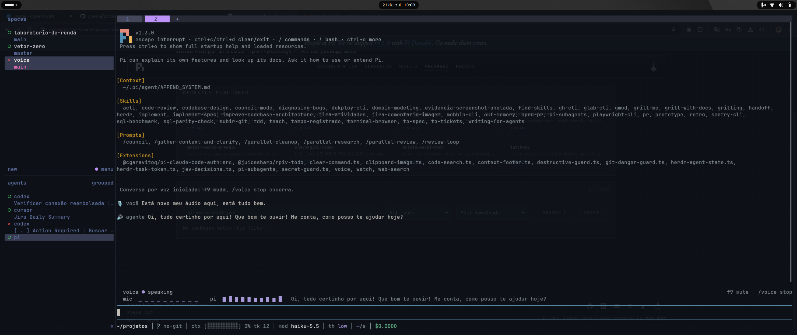

# /voice — modo de voz do Codex CLI, replicado no pi

Conversa por voz full-duplex com o agente, no mesmo desenho do `/voice` do
[openai/codex](https://github.com/openai/codex):

```
/voice
  → abre sessão realtime (mic aberto, VAD do servidor)
  → você fala; o modelo de voz responde falando
  → pedido de trabalho → background_agent → turno normal do agente pi
  → ao terminar, o resultado volta como [BACKEND] + function_call_output (ADR 0002)
  → o modelo de voz resume em 1–3 frases faladas
```

## Demonstração

[](https://raw.githubusercontent.com/IgorGuariroba/pi-voice-realtime/main/docs/media/demo.mp4)

[Assistir à demonstração (MP4, 20 segundos, sem áudio)](https://raw.githubusercontent.com/IgorGuariroba/pi-voice-realtime/main/docs/media/demo.mp4).

## Instalação

Requer Linux com PulseAudio/PipeWire, `pactl`, `parec`, `pacat` e suporte ao
`module-echo-cancel` WebRTC, além de uma credencial OpenAI com acesso à API Realtime.

```bash
pi install npm:pi-voice-realtime
```

Reinicie o pi ou execute `/reload`, depois `/voice`.
Para atualizar uma instalação npm existente, execute `pi update --extensions`.

## Uso

| Comando / tecla | Efeito |
|---|---|
| `/voice` ou `/voice start` | inicia a sessão (idempotente) |
| `/voice stop` | encerra a sessão e libera mic/player |
| `/voice mute` / `unmute` | microfone (não afeta a reprodução) |
| `f9` | alterna mute |
| `/voice settings` | escolhe a voz; ↑↓ toca a prévia (amostra gerada 1x e cacheada em `~/.pi/agent/voice/previews/`) (vale para a próxima sessão) |
| `/voice status` | estado, voz, modelo, credencial, dispositivos |

UI: widget acima do editor (`voice ● listening` / `mic ▁ ▂ ▄ ▆ █ ▅ ▃ ▂ ▁ ▁` / `f9 mute` /
`/voice stop`) + linha no rodapé nativo, que segue mostrando tokens/git/modelo.
Fala consolidada aparece no histórico e entra no contexto do agente como mensagem
`[USER]` sem disparar turno (`sendMessage` sem `triggerTurn`), como o Codex grava
`TranscriptSegment`.

## Credencial

O caminho normal é o login do próprio pi — a extensão lê a mesma credencial:

```
/login openai
/voice status   # credencial: ok
```

Precedência: `OPENAI_API_KEY` → `PI_VOICE_API_KEY` → entrada `openai` de
`~/.pi/agent/auth.json` (é onde o `/login openai` grava). As variáveis de
ambiente servem para uso temporário ou CI.

## Configuração

`~/.pi/agent/voice.json` (criado ao escolher a voz em `/voice settings`):

```json
{ "voice": "marin", "model": "gpt-realtime-2.1-mini", "muteOnStart": false }
```

O caminho AEC atual usa os dispositivos padrão PulseAudio/PipeWire. Remova
`inputDevice`/`outputDevice` se estiverem configurados: dispositivos ALSA explícitos
são rejeitados para evitar que a reprodução contorne a referência de eco.

## Áudio

PCM16LE mono 24 kHz, frames de 20 ms (960 bytes). O caminho ativo requer
Linux, `pactl`, `parec`, `pacat` e `module-echo-cancel` com WebRTC AEC.

Cada sessão cria uma fonte tratada e um sink de referência com nomes únicos:
`parec` lê a fonte com buffer de 30 ms para acompanhar a fala no medidor;
`pacat` envia toda a resposta ao sink. O módulo trata o eco
localmente e mantém full-duplex. Os dispositivos padrão globais não são alterados.
Stop/falhas encerram os processos e solicitam o descarregamento do módulo.
Se o AEC não carregar, a sessão não usa captura crua como fallback.

macOS/Windows não são suportados pelo caminho AEC atual. As funções antigas de
seleção de backend permanecem em `audio.ts`, mas não são usadas por `/voice`.

Este backend usa AEC WebRTC do servidor de áudio; não é o mesmo helper Sonora do
Codex. Criar as rotas não comprova redução de eco: a medição e a validação acústica
no alto-falante ainda estão pendentes.

## Fidelidade ao Codex (o que difere e por quê)

| Codex | Aqui | Motivo |
|---|---|---|
| `/v1/realtime?intent=quicksilver` + auth ChatGPT | `/v1/realtime` + API key | `intent=quicksilver` não é público |
| Autenticação do transporte | `ws` + `Authorization` | GA não envia `OpenAI-Beta`; ver abaixo |
| WebRTC (SDP/ICE) | WebSocket PCM16 | mesmo modelo e mesmo VAD; evita `wrtc` nativo |
| helper Rust + Sonora AEC + GStreamer + Opus | PulseAudio/PipeWire WebRTC AEC + `parec`/`pacat` | backend Linux, sem equivalência acústica comprovada |
| handoff V2 (`background_agent`, `remain_silent`) | mesmas tools, mesmos textos de retorno | paridade (ADR 0002) |
| módulo `codex-realtime-webrtc` | `socket.ts` + `realtime.ts` + `audio.ts` | — |

### Transporte

`import("ws")` falha a partir do diretório da extensão, mas
`createRequire(process.argv[1])("ws")` funciona: `process.argv[1]` é o entrypoint
do pi, dono do `node_modules` onde `ws` vive. Com isso o transporte é o mesmo do
Codex (headers). Se essa resolução falhar (execução fora do pi), a extensão cai
no `WebSocket` global do Node — que **não** aceita headers — e então troca a API
key por um client secret efêmero em subprotocolo. O modo em uso aparece em
`/voice status`: `transporte: ws|global-websocket · auth: header|ephemeral-subprotocol`.

### Dialeto do payload

Só o formato GA (`session.update` da V2 do Codex). O dialeto beta foi removido: a V2
não o usa. Erros de `session.update` são reportados, sem reenvio em outro formato.

### OpenRouter não serve para o modo realtime

OpenRouter oferece `/api/v1/audio/speech` (TTS) e `/api/v1/audio/transcriptions`
(STT) e `gpt-audio` via `/chat/completions`, mas **não** expõe endpoint de sessão
duplex (`/v1/realtime`). Sem isso não há VAD contínuo, barge-in nem resposta
falada em streaming. Usar OpenRouter implicaria um modo diferente (grava →
transcreve → agente → TTS), que foi explicitamente descartado no escopo da v1.

O que é fiel ao Codex V2: resposta falada pelo próprio modelo, delegação como
`background_agent` com envelope `<realtime_delegation>`, progresso e resultado como
`[BACKEND]`, `function_call_output` ao concluir e no steer, fila de um
`response.create` por vez, barge-in com `conversation.item.truncate`, fala no
histórico do agente, e `remain_silent`.

## Testes

```bash
node --test --experimental-strip-types ~/.pi/agent/extensions/voice/tests/*.test.ts
```

A suíte cobre também lifecycle da sessão realtime, handshake GA e propriedade das
rotas AEC (comandos de criação, uso do par e descarregamento idempotente).
Esses testes não medem o desempenho acústico do cancelador.

Cobertura offline: parser de eventos GA com fixture, payload `session.update` V2
(VAD, ferramentas, instruções), envelope de delegação, fila de `response.create`,
truncate no barge-in, ciclo do handoff com socket falso (`tests/integration.test.ts`),
contexto de início e framing PCM.

## Estado da validação

Comprovado: testes offline acima, conversa real com transcrição e resposta falada
no pi, e validação visual do medidor. A captura real pelo caminho AEC entregou
blocos a cada 27–32 ms após a inicialização, com o buffer configurado em 30 ms.

Ainda pendentes de validação E2E específica: qualidade acústica do cancelamento
de eco, barge-in contra o servidor e o ciclo completo de delegação
fala → tarefa do agente → resposta falada.

## Limites conhecidos

- Device picker e captions persistentes ficaram para a v2 (decisão de escopo).
- Sem fase de reconexão: queda do WebSocket encerra a sessão (Codex: `reconnect.rs`).
- Sem transcript-tail-flush com turno: a fala já vai ao histórico na hora, então não sobra buffer ao encerrar.
- Sem chave OpenAI, `/voice` avisa e não abre sessão — não há fallback local.
- Reconexão automática não implementada: queda do WebSocket encerra a sessão.
- A sessão mantém o microfone aberto até `/voice stop` (igual ao Codex), o que
  consome áudio mesmo em silêncio.
